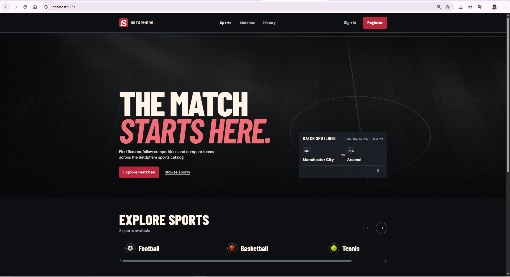
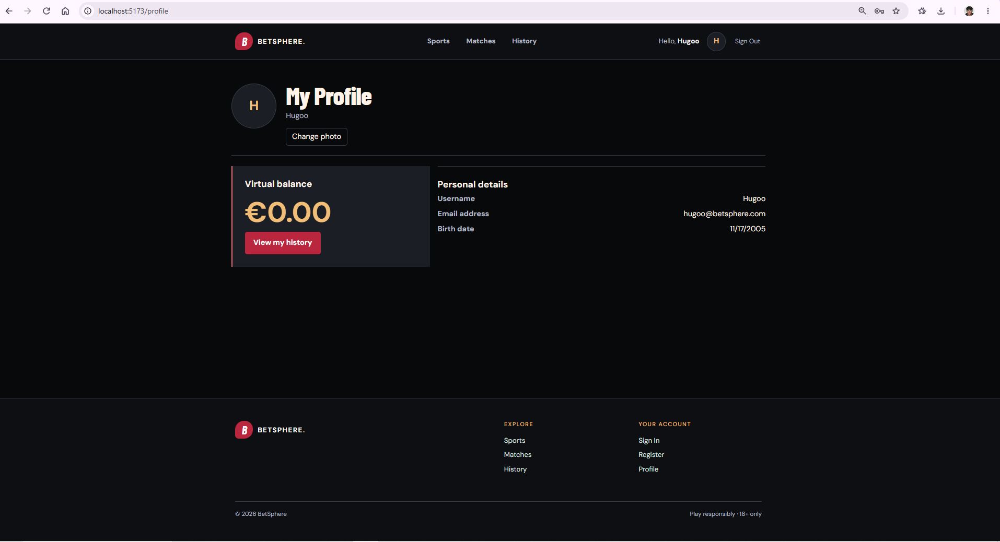
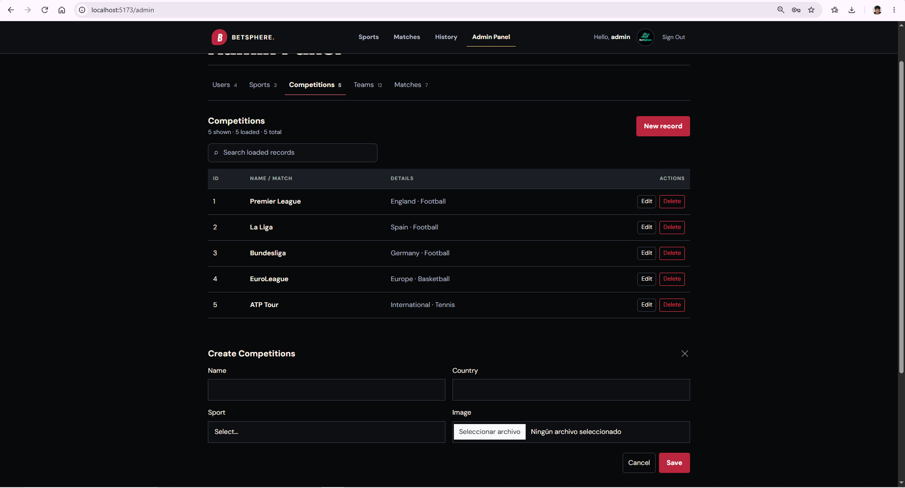

<h1>
  
  BetSphere: una aplicación web para seguir eventos deportivos y simular apuestas
</h1>

La versión 0.1 de BetSphere permite explorar deportes y competiciones, buscar partidos y comparar las estadísticas de los equipos. Los usuarios registrados pueden iniciar sesión, cambiar su avatar y volver a los últimos partidos que visitaron. El administrador puede consultar las cuentas y gestionar el catálogo deportivo y sus partidos. Las cuotas se muestran como referencia durante esta fase.

**BetSphere sigue en desarrollo.** La simulación de apuestas se incorporará en próximas versiones. Consulta las [funcionalidades de la 0.1](docs/functionalities.md) para ver qué está disponible por rol.

## Vídeo de la versión 0.1

**[Ver la demo de BetSphere 0.1 en YouTube](https://youtu.be/Ru065-V4QDI)**

La demo muestra la navegación por el catálogo como visitante, el registro y las pantallas de perfil e historial como usuario registrado, y la creación y eliminación de un deporte desde el panel de administración.

## Capturas de la versión 0.1

| Perfil de usuario | Panel de administración |
| --- | --- |
|  |  |
| Consulta de la cuenta y cambio de avatar. | Gestión de deportes, competiciones y equipos. |

## Funcionalidades previstas

Las próximas versiones incorporarán la simulación de apuestas simples y combinadas con saldo virtual, el historial de apuestas, el chat durante los partidos y los resúmenes de encuentros asistidos por IA. Consulta el [estado de las funcionalidades detalladas](docs/detailed-functionalities.md).

## Documentación

| Sección | Contenido |
| --- | --- |
| [Funcionalidades de la 0.1](docs/functionalities.md) | Funciones disponibles y capturas por rol. |
| [Funcionalidades detalladas](docs/detailed-functionalities.md) | Alcance y estado de implementación de cada función. |
| [Ejecución de la aplicación](docs/execution.md) | Requisitos y pasos para ejecutar BetSphere desde Docker Hub. |
| [Guía de desarrollo](docs/development-guide.md) | Arquitectura, entorno local, despliegue y versionado. |
| [Estructura de pruebas](docs/testing-structure.md) | Organización de las pruebas del proyecto. |
| [Estado del arte](docs/state-of-art.md) | Contexto y soluciones relacionadas. |
| [Objetivos](docs/objectives.md) | Propósito y alcance del TFG. |
| [Requisitos del sistema y características técnicas](docs/analysis.md) | Análisis del proyecto. |
| [Metodología](docs/methodology.md) | Organización del desarrollo. |
| [Seguimiento](docs/follow-up.md) | Planificación y evolución del trabajo. |
| [Autor](docs/authors.md) | Autoría del proyecto. |
| [Uso de IA](#uso-de-ia) | Herramientas utilizadas y registro de su uso. |
| [Historial de cambios](CHANGELOG.md) | Cambios y avances registrados. |

## Uso de IA

El uso de herramientas basadas en Inteligencia Artificial Generativa se ha articulado bajo principios de transparencia académica y eficiencia técnica. El detalle completo de las interacciones, prompts y trazabilidad se encuentra recogido en el archivo [`AI_USAGE.md`](./docs/AI_USAGE.md).

- **Google Gemini:** Utilizado como asistente interactivo para la investigación temática del sector, delimitación del alcance y funcionalidades, definición del estado del arte, estructuración de la documentación técnica y refinamiento formal del texto de la memoria.
- **OpenAI Codex:** Empleado como herramienta de apoyo en el prototipado inicial de las pantallas, maquetación de la interfaz de usuario y estructura base de navegación.
