# Guía de desarrollo

## Índice

- [Introducción](#introducción)
- [Tecnologías](#tecnologías)
- [Herramientas](#herramientas)
- [Arquitectura](#arquitectura)
- [Control de calidad](#control-de-calidad)
- [Despliegue](#despliegue)
- [Proceso de desarrollo](#proceso-de-desarrollo)
- [Ejecución y edición del código](#ejecución-y-edición-del-código)

## Introducción

BetSphere es una aplicación web para consultar un catálogo deportivo y gestionar sus datos. El alcance de la versión 0.1 incluye deportes, competiciones, equipos y partidos, registro e inicio de sesión, perfil con avatar y administración del catálogo. La interfaz también muestra los últimos partidos visitados por cada usuario en ese navegador. Consulta las [funcionalidades de la versión 0.1](functionalities.md) y el [estado de las funcionalidades previstas](detailed-functionalities.md).

El navegador ejecuta una SPA de React que consume una API REST de Spring Boot. MySQL guarda las entidades del catálogo y las cuentas. MinIO proporciona almacenamiento de objetos compatible con S3 para imágenes. Durante el desarrollo Vite y Spring Boot se ejecutan por separado. La imagen distribuida sirve el cliente y la API desde Spring Boot, bajo el mismo origen HTTPS.

## Tecnologías

| Área | Tecnologías | Uso |
| --- | --- | --- |
| Cliente | React, TypeScript, React Router, Vite, Bootstrap y React Bootstrap | Interfaz, rutas, compilación y estilos. |
| Estado del cliente | Zustand y almacenamiento del navegador | Estado de sesión en memoria y registro local de partidos visitados. |
| Servidor | Java 21, Spring Boot y Spring MVC | API REST y distribución del cliente compilado. |
| Seguridad | Spring Security y JWT | Autenticación, renovación de sesión y autorización por rol. |
| Persistencia | Spring Data JPA, Hibernate y MySQL 8.0 | Mapeo y almacenamiento de las entidades relacionales. |
| Intercambio de datos | DTO, MapStruct y Lombok | Contratos de la API, transformación de entidades y reducción de código repetitivo. |
| Imágenes | AWS SDK para S3 y MinIO | Almacenamiento de avatares, logos e iconos. |

## Herramientas

| Herramienta | Uso |
| --- | --- |
| Git, GitHub Issues y GitHub Projects | Control de versiones y seguimiento de tareas. |
| GitHub Actions | Integración continua, compilación de imágenes y publicación de artefactos. |
| Maven Wrapper | Compilación, pruebas y arranque local del servidor. |
| Node.js y npm | Instalación de dependencias, servidor de desarrollo, pruebas y compilación del cliente. |
| Docker, Compose y Docker Hub | Servicios auxiliares locales y distribución del despliegue. |
| Springdoc OpenAPI y Postman | Inspección y pruebas manuales de la API REST. |
| ESLint, Vitest, JUnit, Mockito, Testcontainers, REST Assured, Selenium y JaCoCo | Análisis del cliente, pruebas automatizadas y cobertura. |

## Arquitectura

### Modelo del dominio

El diagrama recoge las cinco entidades JPA persistentes. Los extremos indican cuántas instancias pueden participar en cada relación. Las referencias JPA aparecen como asociaciones y los demás campos como atributos.

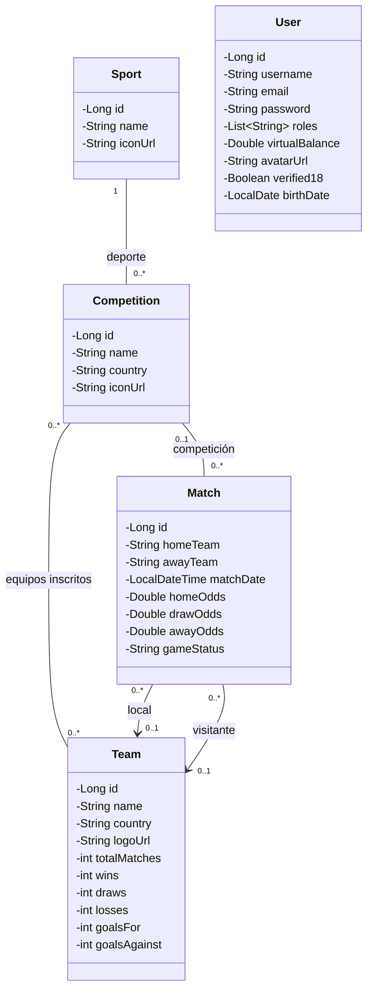

Cada competición requiere un deporte. Las inscripciones de equipos se guardan en una tabla de unión. Un partido puede conservar los nombres de los participantes aunque las referencias a equipos sean nulas. Las asociaciones local y visitante corresponden a `homeTeamRef` y `awayTeamRef`, respectivamente. Los roles de usuario se guardan como una colección de cadenas y la contraseña se almacena codificada. Los campos de imagen guardan URLs y los binarios se guardan en MinIO. El historial de partidos visitados se guarda en el navegador y carece de entidad JPA.

### API REST

La API usa el prefijo `/api/v1` y se sirve por HTTPS en `https://localhost` con la configuración local del backend. Las operaciones de catálogo y cuenta intercambian JSON. Las cargas de imágenes usan `multipart/form-data` y la consulta de una imagen devuelve el binario.

La tabla usa rutas relativas a `/api/v1`. La autenticación devuelve un token de acceso que el cliente envía como `Authorization: Bearer <token>`. El servidor entrega el token de renovación mediante una cookie HttpOnly.

| Recurso | Operaciones disponibles | Acceso |
| --- | --- | --- |
| `/sports` | `GET` listado, `/options` y `/{id}`. `POST` alta e imagen en `/{id}/image`. `PUT` y `DELETE` en `/{id}`. | Lectura pública. Escritura de administrador. |
| `/competitions` | `GET` listado, `/options`, `/by-sport/{sportId}` y `/{id}`. `POST` alta e imagen en `/{id}/image`. `PUT` y `DELETE` en `/{id}`. `POST /{id}/teams` crea y vincula un equipo. `POST` o `DELETE /{id}/teams/{teamId}` vincula o desvincula uno existente. | Lectura pública. Escritura de administrador. |
| `/teams` | `GET` listado y `/{id}`. `PUT` y `DELETE` en `/{id}`. `POST /{id}/image` actualiza su imagen. | Lectura pública. Escritura de administrador. |
| `/matches` | `GET` listado, `/by-competition/{competitionId}` y `/{id}`. `POST` alta. `PUT` y `DELETE` en `/{id}`. | Lectura pública. Escritura de administrador. |
| `/auth` | `POST /login`, `POST /refresh` y `POST /logout`. | Entrada pública. La renovación requiere una cookie válida. |
| `/users` | `POST /` registro. `GET /me` sesión actual. `GET /` listado. `GET`, `PUT` y `DELETE` en `/{id}`. | Registro público. Listado de administrador. Consulta, edición y eliminación de una cuenta sujetas a los permisos del titular o administrador. |
| `/images` | `GET /{key}` consulta, `POST` carga de avatar y `DELETE /{key}` retirada del avatar propio. | Lectura pública. Escritura autenticada. |

El proyecto configura `/docs/api` para Swagger UI y `/v3/api-docs` para el JSON de OpenAPI. El POM combina Spring Boot 4.1 con Springdoc 2.5, fuera de la [matriz de compatibilidad de Springdoc](https://springdoc.org/#what-is-the-compatibility-matrix-of-springdoc-openapi-with-spring-boot). La generación dinámica de la especificación queda por verificar. La [exportación estática anterior](api/api-docs.yaml) corresponde a la primera implementación del listado de partidos. Para revisar las rutas de la versión actual utiliza el inventario anterior, los controladores y los tests HTTP. La [colección de Postman](api/postman/BetSphere_API.postman_collection.json) puede servir como punto de partida para peticiones manuales.

### Arquitectura del servidor

Cada flecha discontinua va desde una clase a su dependencia directa. Las vistas se leen de izquierda a derecha. Si una clase aparece en varias, se trata de la misma clase.

#### Recorrido del catálogo

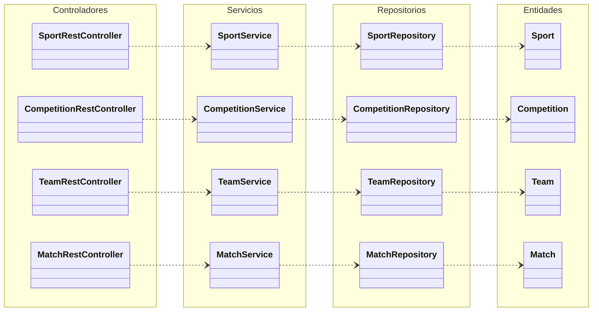

#### Consultas entre recursos del catálogo

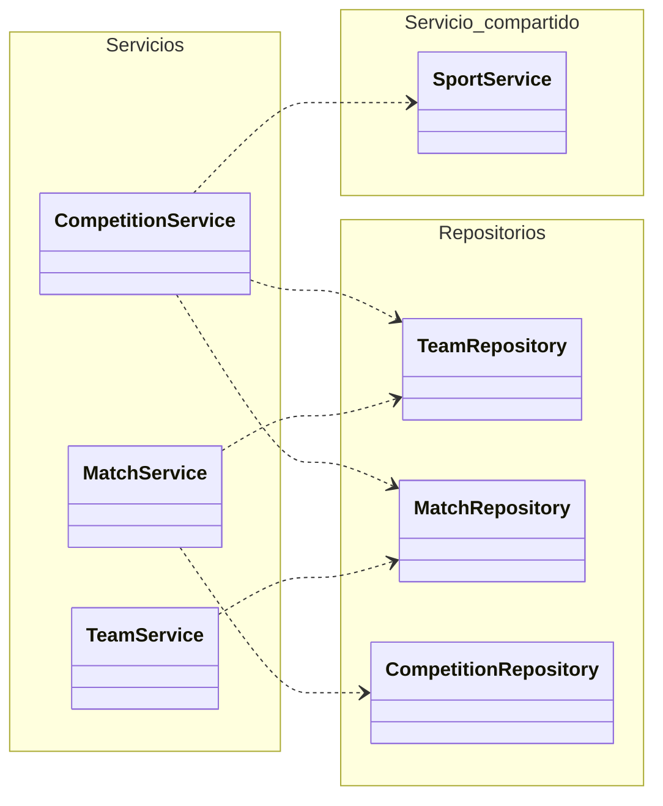

#### Cuentas y almacenamiento de imágenes

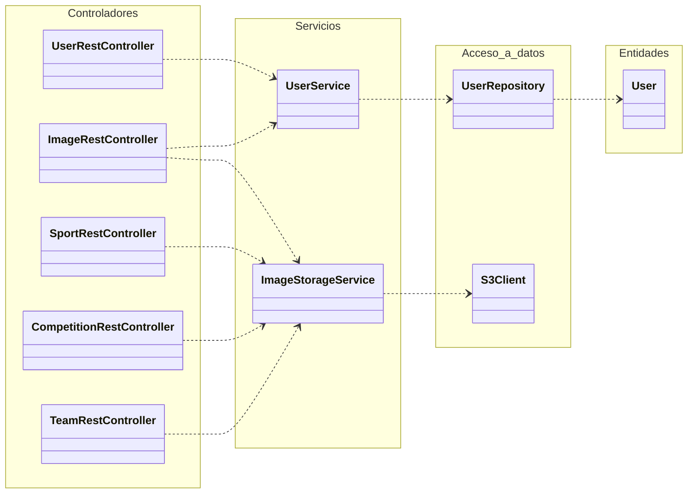

#### Inicio de sesión y verificación del token

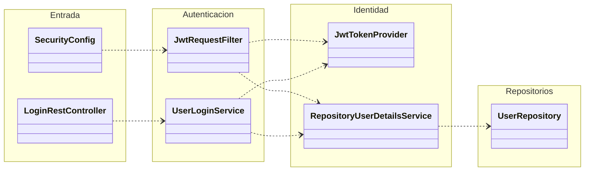

#### Conversión de entidades a DTO

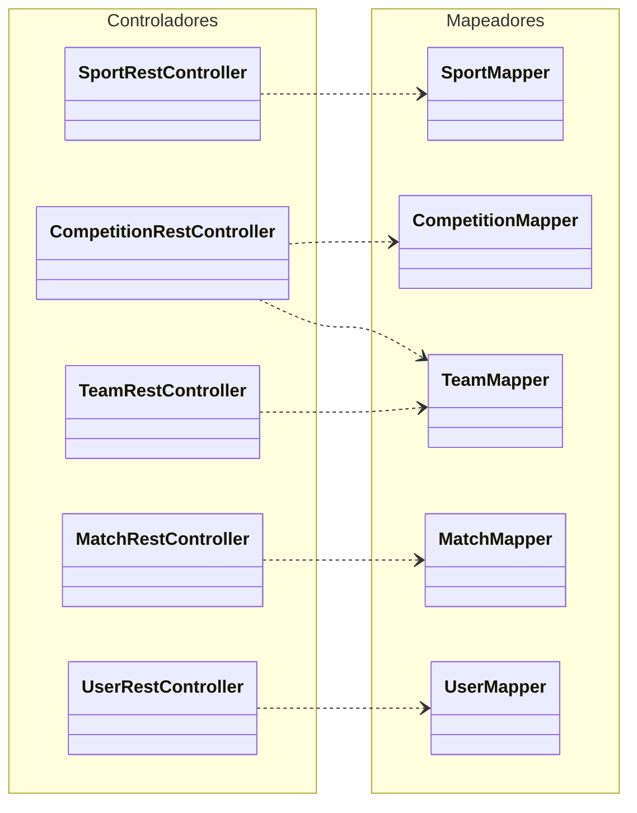

#### Inicialización de datos de ejemplo

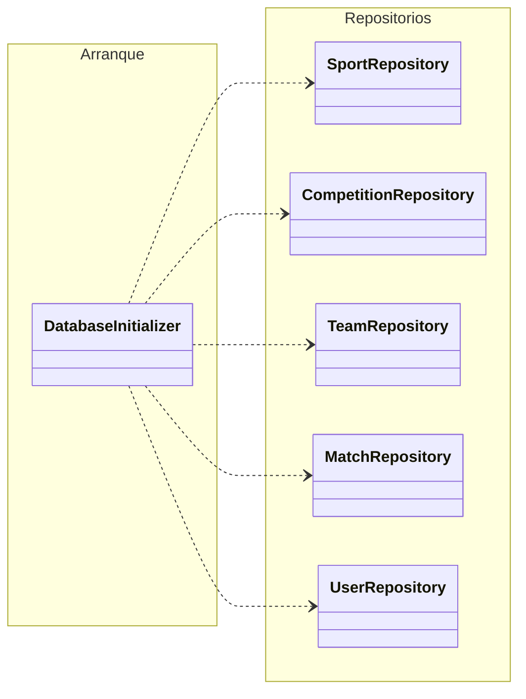

#### Dependencias de infraestructura

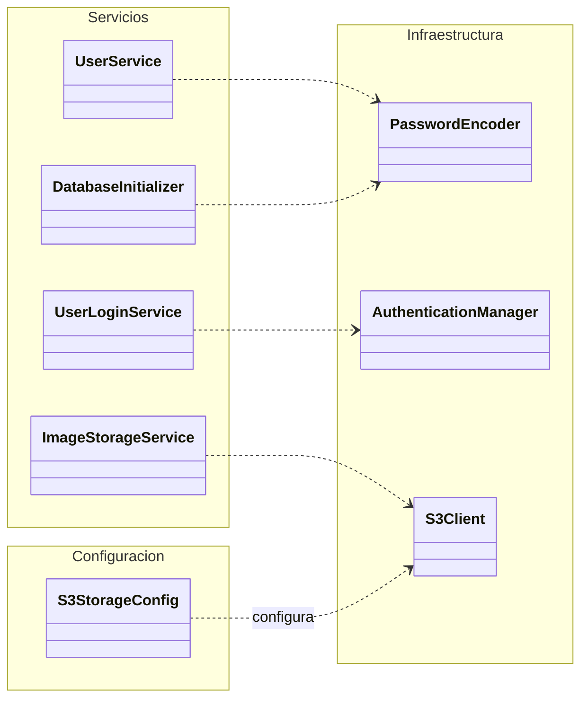

La capa web también incluye `WebController`, que reenvía las rutas de navegación a `index.html`. Este controlador no invoca servicios del dominio.

| Capa | Responsabilidad |
| --- | --- |
| Controladores REST | Reciben peticiones, coordinan servicios y devuelven respuestas HTTP. Los controladores de deportes, competiciones y equipos también usan `ImageStorageService` para sus imágenes. |
| Presentación web | `WebController` reenvía las rutas de navegación a `index.html` para que React Router resuelva la vista. |
| Servicios | Aplican las reglas del catálogo y las cuentas, coordinan repositorios y gestionan imágenes mediante S3. `DatabaseInitializer` usa los repositorios para preparar los datos de ejemplo cuando está habilitado. |
| Repositorios y entidades | Los repositorios Spring Data JPA consultan y guardan entidades. Hibernate persiste atributos y relaciones en MySQL. |
| DTO y mapeadores | Delimitan los datos de entrada y salida. Los controladores usan mapeadores como `CompetitionMapper` y `UserMapper` para convertir entidades a los DTO correspondientes. |
| Seguridad y configuración | `SecurityConfig` aplica las reglas de acceso y usa `JwtRequestFilter` para resolver la identidad con `JwtTokenProvider` y `RepositoryUserDetailsService`. `S3StorageConfig` configura el cliente de almacenamiento. |

### Arquitectura del cliente

Las cajas representan módulos TypeScript y componentes React. Las flechas muestran los imports directos entre los módulos propios de cada vista. Las vistas separan los usos de un mismo módulo para evitar cruces entre recorridos. Los DTO describen los datos intercambiados en la API.

#### Pantallas y lectura del catálogo

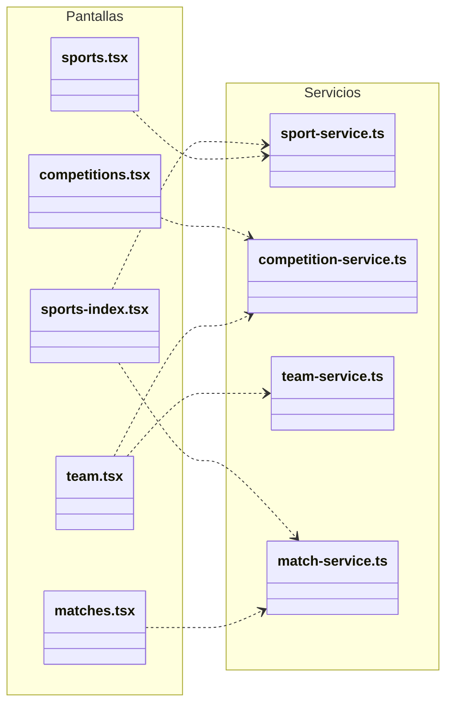

#### Componentes compartidos de navegación y catálogo

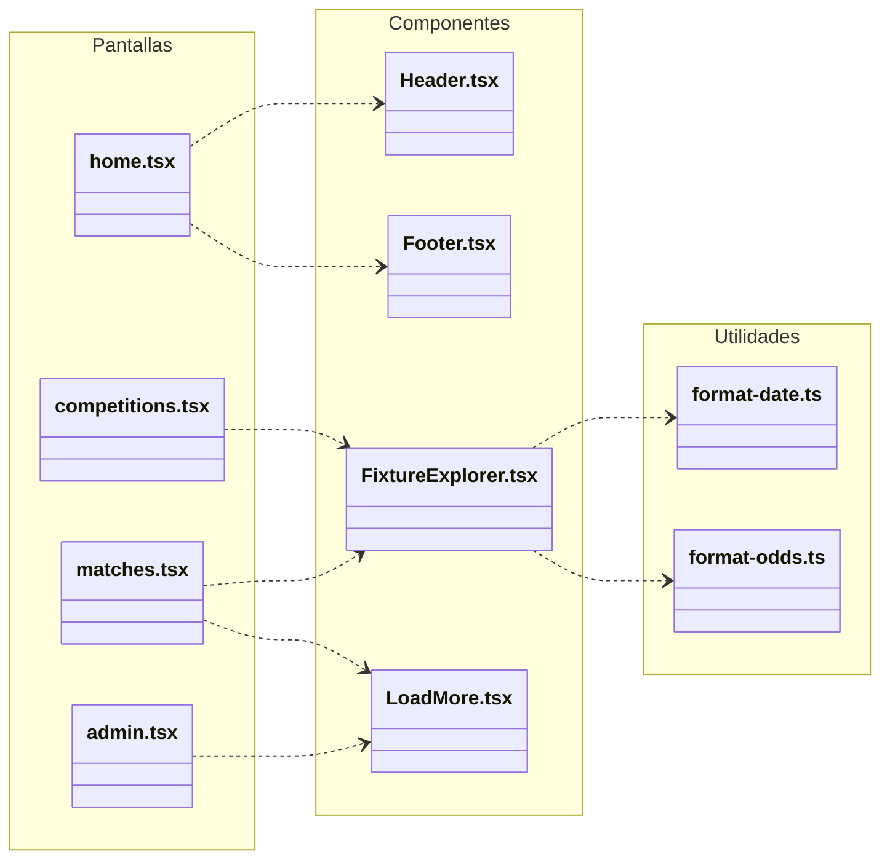

#### Administración del catálogo

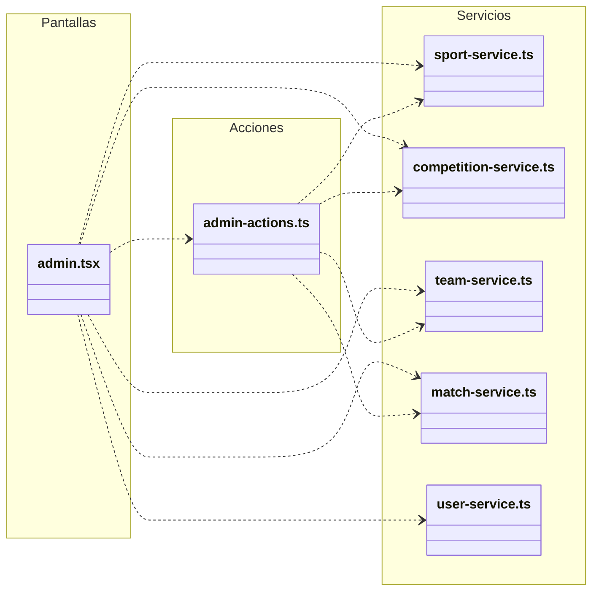

#### Transporte HTTP de catálogo y usuarios

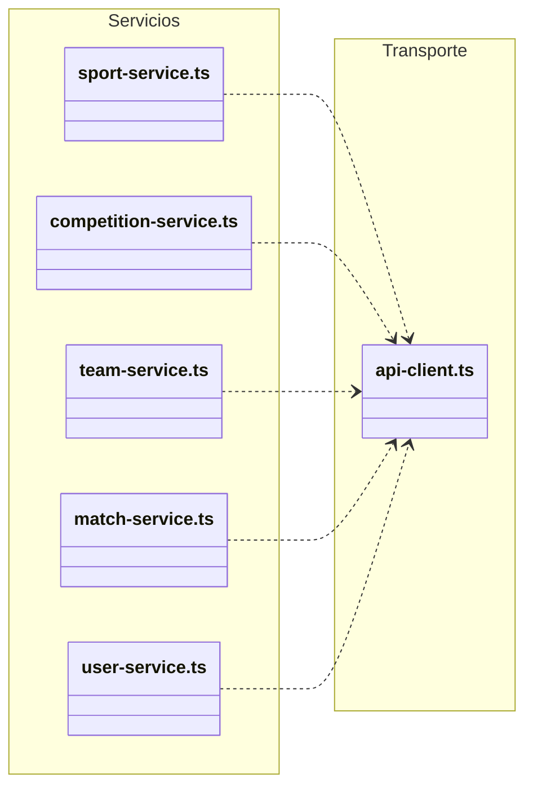

#### Formularios y validación

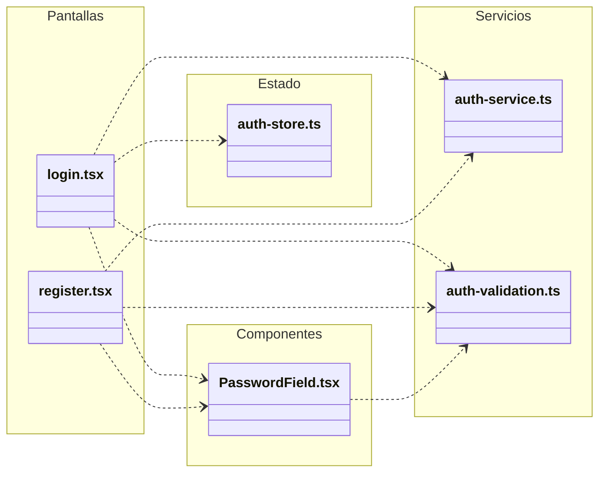

#### Sesión, perfil y control de acceso

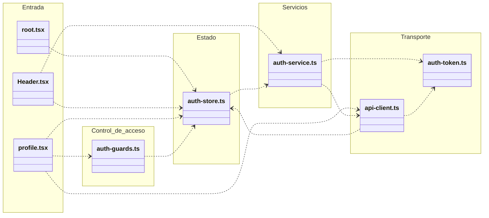

#### Detalle de partido, historial y utilidades

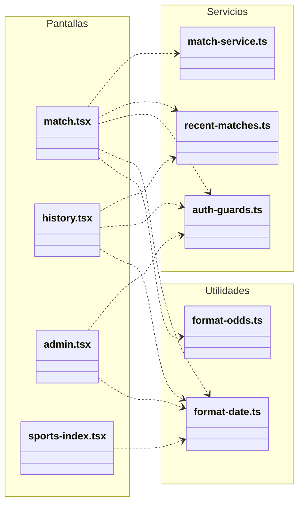

| Capa | Responsabilidad |
| --- | --- |
| Rutas y diseño común | `routes.ts` asocia URLs con pantallas. Las rutas cargan datos y coordinan vistas. `root.tsx` restaura la sesión y `home.tsx` incorpora el encabezado y el pie comunes. |
| Componentes | Presentan datos y controles reutilizables. `FixtureExplorer` muestra partidos, `LoadMore` activa la carga de más resultados y `PasswordField` encapsula el campo de contraseña. |
| Servicios | Agrupan las llamadas al catálogo, cuentas y autenticación. `admin-actions.ts` coordina operaciones del catálogo. `user-service.ts` alimenta la lista de usuarios en administración. `recent-matches.ts` guarda en `localStorage` las visitas registradas desde `match.tsx`. |
| Estado y transporte | `auth-store.ts` conserva la sesión en memoria con Zustand. `api-client.ts` realiza las peticiones HTTP y coordina la renovación con `auth-token.ts`. Los tipos de `dtos/` describen los datos intercambiados. |

## Control de calidad

| Nivel | Herramientas y alcance |
| --- | --- |
| Unitaria del servidor | JUnit y Mockito para reglas del catálogo, cuentas, autenticación e imágenes con dependencias controladas. |
| Unitaria del cliente | Vitest y Testing Library para componentes, rutas, formularios, sesión y servicios TypeScript. |
| Integración del servidor | Spring Boot y Testcontainers con MySQL y almacenamiento compatible con S3 para comprobar persistencia y servicios. |
| Integración cliente y API | Selenium ejecuta funciones TypeScript del cliente en Chrome contra la API real. |
| E2E de API | REST Assured prueba operaciones HTTP de catálogo, autenticación, cuentas, administración e imágenes. |
| E2E de interfaz | Selenium comprueba recorridos de usuario en Chrome con cliente, servidor y servicios reales de prueba. |

Maven escribe los resultados de Surefire en `backend/target/surefire-reports/` y JaCoCo genera cobertura en `backend/target/site/jacoco/`. Vitest genera cobertura en `frontend/coverage/`. Los porcentajes dependen del commit y de la ejecución consultada. La [estructura de pruebas](testing-structure.md) identifica las suites y sus comandos.

## Despliegue

### Empaquetado y distribución

El [Dockerfile](../docker/dockerfile) compila el cliente con Node.js, copia su salida estática al backend y empaqueta ambos en un JAR de Spring Boot. La imagen resultante contiene una única aplicación con cliente y servidor y expone HTTPS en el puerto 443.

[Docker Compose](../docker/docker-compose.yml) coordina esa imagen con MySQL, MinIO y la tarea `minio-init`, que prepara el bucket antes de arrancar la aplicación. MySQL y MinIO conservan sus datos en volúmenes. El método de distribución de esta entrega es Compose como artefacto OCI.

| Artefacto | Distribución |
| --- | --- |
| Imagen de aplicación | [huugoocm/betsphere](https://hub.docker.com/r/huugoocm/betsphere/tags) |
| Compose OCI | [huugoocm/betsphere-compose](https://hub.docker.com/r/huugoocm/betsphere-compose/tags) |

Para ejecutar las imágenes publicadas y preparar un servidor externo, consulta la [guía de ejecución](execution.md).

## Proceso de desarrollo

### Gestión de tareas

El desarrollo es iterativo e incremental. GitHub Issues recoge las tareas de cada fase y GitHub Projects permite seguirlas con Kanban a través de los estados Todo, In Progress, Review y Done. Cada tarea describe un resultado verificable y sus criterios de aceptación. La [metodología](methodology.md) detalla la organización del trabajo.

### Git

El trabajo se realiza en ramas cortas asociadas a un issue, como `docs/p3-44-development-guide`. Cada rama propone su integración en `main` mediante una pull request. La revisión de la PR y el resultado de Full CI sirven para decidir la integración.

### Integración y entrega continua

| Workflow | Disparador | Resultado |
| --- | --- | --- |
| Basic Backend CI | Push o ejecución manual | Compila el servidor y ejecuta las pruebas de Maven salvo las suites de navegador. |
| Basic Frontend CI | Push | Compila el cliente y ejecuta Vitest con cobertura. |
| Full CI | Pull request hacia `main` | Ejecuta pruebas del cliente, compilación, suites completas de Maven y pruebas de los scripts de versiones. |
| Continuous Delivery | Push a `main` | Publica la imagen y el Compose OCI con el tag `dev`, a partir del SHA del cambio. |
| Manual Build | Ejecución manual con rama y SHA opcional | Publica una build identificable por rama, fecha UTC y SHA abreviado. |
| GitHub Release | Publicación de una release | Valida el tag y publica la imagen y el Compose OCI con las etiquetas de la versión y `latest`. |

El [publicador reutilizable](../.github/workflows/publish-artifacts.yml) construye la imagen y prepara el Compose con la etiqueta correspondiente. Usa `DOCKERHUB_USERNAME` y `DOCKERHUB_TOKEN` como secretos de GitHub Actions. Al terminar registra el SHA, el digest de la imagen y las referencias publicadas. Las builds de Continuous Delivery se serializan y las de Manual Build usan etiquetas propias.

### Versionado

**Prepare Version** requiere que GitHub Actions pueda crear pull requests. Si el token predeterminado deja las comprobaciones esperando aprobación, apruébalas desde la PR. El workflow admite el secreto opcional `VERSION_BUMP_TOKEN` con acceso de escritura a Contents y Pull requests para iniciar las comprobaciones automáticamente.

### Publicación de una release de GitHub

1. Ejecuta **Prepare Version** con `operation=release` y la versión elegida. Revisa los cambios en Maven, npm, el lockfile y la etiqueta de Compose. Integra la PR cuando pase CI.
2. Crea una release en GitHub sobre el commit de `main` que contiene las versiones preparadas. Usa notas con las funcionalidades principales, cambios y limitaciones. Para la entrega 0.1 se usa el tag `0.1` y los paquetes se versionan como `0.1.0`.
3. Publica la release y revisa el resultado de **GitHub Release**. El workflow valida las versiones a partir del commit etiquetado y publica sus artefactos con los tags de versión y `latest`. Para `0.1` publica también `0.1.0` como alias. Una prerelease numérica también actualiza `latest` con el workflow actual.
4. Tras la publicación correcta, revisa la PR de preparación de la siguiente versión de desarrollo. Después de `0.1` se propone `0.2.0-SNAPSHOT` en Maven y `0.2.0` en npm.

En [GitHub Releases](https://github.com/codeurjc-students/2026-BetSphere/releases) se consultan las fechas de publicación de las releases y en el [changelog](../CHANGELOG.md) los hitos registrados del proyecto.

| Hito | Fecha registrada | Alcance |
| --- | --- | --- |
| `0.1.0-fase1` | 2026-09-18, changelog de Fase 1 | Definición del alcance, navegación y arquitectura inicial. |
| `0.2.0-fase2` | 2026-10-06, changelog de Fase 2 | Primera SPA y API del catálogo de partidos, persistencia inicial y pruebas automatizadas. |
| Entrega `0.1` | Publicación por confirmar en GitHub Releases | Catálogo deportivo, registro y sesión, perfil con avatar, historial local de partidos visitados y administración. |

Las fechas de las dos primeras filas corresponden a entradas del changelog. El artefacto `dev` se actualiza con los cambios de `main`.

## Ejecución y edición del código

Para trabajar con el código instala Git, un JDK 21, Node.js 22 compatible con Vite y npm, y Docker con Compose. Para las pruebas de navegador instala Chrome. Clona el repositorio:

```sh
git clone https://github.com/codeurjc-students/2026-BetSphere.git
cd 2026-BetSphere
```

### MySQL y MinIO

Arranca MySQL y MinIO desde la raíz. En Bash puedes usar `bash start_db.sh` y `bash start_minio.sh`. En PowerShell 7, puedes iniciar una instancia nueva con estos comandos:

```powershell
$env:MYSQL_ROOT_PASSWORD = Read-Host 'Contraseña para MySQL local' -MaskInput
docker run --name mysql-betsphere -e MYSQL_ROOT_PASSWORD -e MYSQL_DATABASE=betsphere -p 3306:3306 -d mysql:8.0
Remove-Item Env:MYSQL_ROOT_PASSWORD
docker compose -f docker/docker-compose-dev.yml up -d minio
```

Si el contenedor MySQL ya existe, reutilízalo con `docker start mysql-betsphere`. Si usaste el script Bash, utiliza el valor de desarrollo definido en ese script. Si la base ya existe, utiliza sus credenciales. MinIO escucha en el puerto 9000 y su consola en el 9001.

### Backend

Desde `backend/`, copia [`.env.template`](../backend/.env.template) a `.env` y rellena la configuración local. Para el contenedor de ejemplo usa `DB_HOST=localhost`, `DB_PORT=3306`, `DB_NAME=betsphere` y `DB_USER=root`, junto con la contraseña elegida al crear MySQL. Los valores `S3_*` deben corresponder a la instancia de MinIO. Las variables `KEYSTORE_PASSWORD` y `KEYSTORE_SECRET` deben corresponder a `backend/src/main/resources/keystore.jks`. Guarda los valores propios fuera del control de versiones.

```powershell
cd backend
.\mvnw.cmd spring-boot:run
```

En Bash usa `./mvnw spring-boot:run`. La API escucha en `https://localhost`. Ajusta la URL base de Postman si la colección conserva el puerto anterior. Una comprobación básica es consultar `GET https://localhost/api/v1/matches/`.

### Frontend

Desde una segunda terminal en la raíz del repositorio:

```sh
cd frontend
npm ci
npm run dev
```

Abre `http://localhost:5173` o la URL indicada por Vite. Vite redirige las peticiones a `/api` hacia `https://localhost:443` de forma predeterminada. La variable `API_PROXY_TARGET` permite cambiar ese destino al iniciar Vite.

Edita pantallas y servicios en `frontend/app/` y el servidor en `backend/src/main/java/es/codeurjc/betsphere/`. Vite actualiza el navegador al editar el cliente. Para cambios del backend, vuelve a iniciar Maven si la aplicación no se reinicia automáticamente.

### Compilación y pruebas

Desde `frontend/`:

```sh
npm run lint
npm run test:coverage
npm run build
```

Desde `backend/`, con Docker activo y dependencias del frontend instaladas:

```powershell
.\mvnw.cmd test
```

En Bash usa `./mvnw test`. Para comprobar desde la raíz los scripts de publicación y versionado:

```sh
node --test .github/scripts/*.test.mjs
```

Para construir la imagen conjunta desde la raíz:

```sh
docker build -f docker/dockerfile -t betsphere:local .
```
