# Funcionalidades de la versión 0.1

La versión 0.1 permite consultar el catálogo deportivo y las estadísticas de los equipos, acceder a una cuenta de usuario y administrar deportes, competiciones, equipos y partidos. A continuación se describen las funcionalidades disponibles en la interfaz, separadas por tipo de usuario.

## Usuario anónimo

### Consulta de deportes y competiciones

La página principal muestra el catálogo de deportes y una selección de partidos. Al seleccionar un deporte se accede a sus competiciones, con filtro por país cuando hay varios disponibles. La ficha de competición muestra sus equipos y calendario y permite abrir sus detalles.

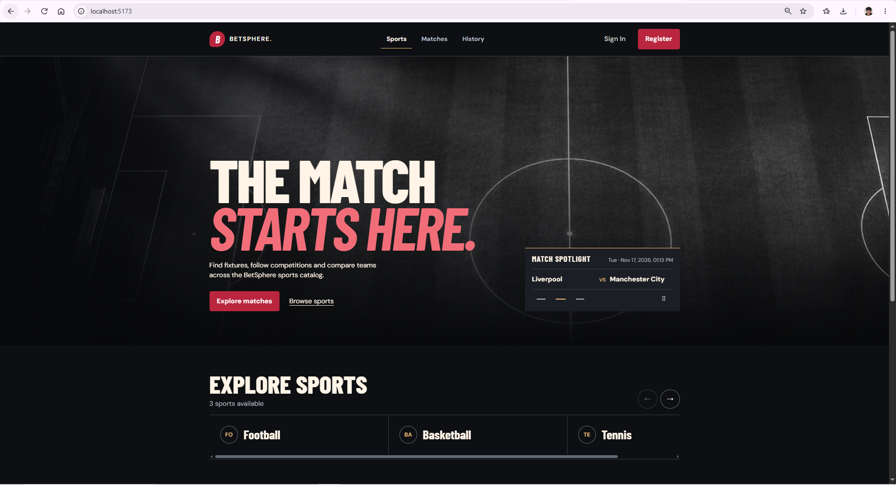

*Página principal con acceso a los deportes y partidos destacados.*

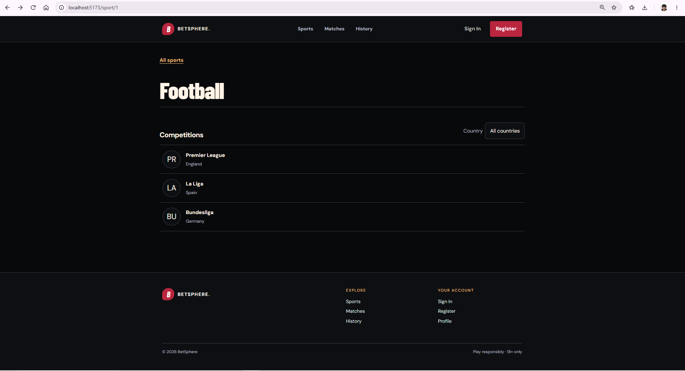

*Competiciones de un deporte, con selección de país.*

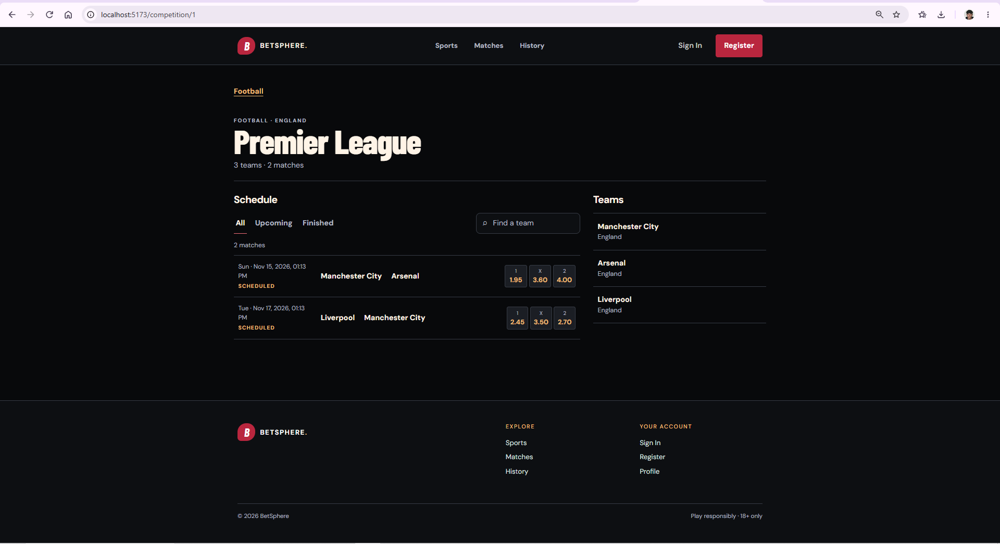

*Ficha de competición con sus partidos, cuotas de referencia y equipos.*

### Búsqueda y filtrado de partidos

El listado permite buscar partidos por nombre de equipo y filtrar entre todos, próximos o finalizados. El botón «Load more» carga más resultados en grupos de diez. La búsqueda y los filtros se aplican a los partidos ya cargados.

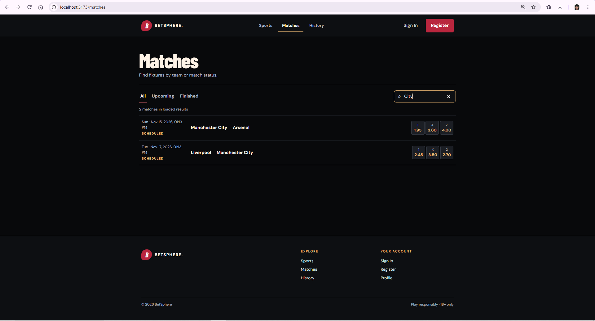

### Detalle de partido y comparación de equipos

La ficha muestra los equipos, competición, fecha, estado y cuotas de referencia 1X2. Permite comparar victorias y goles a favor y en contra, y desplegar las estadísticas de temporada. Las cuotas son informativas y no permiten realizar apuestas.

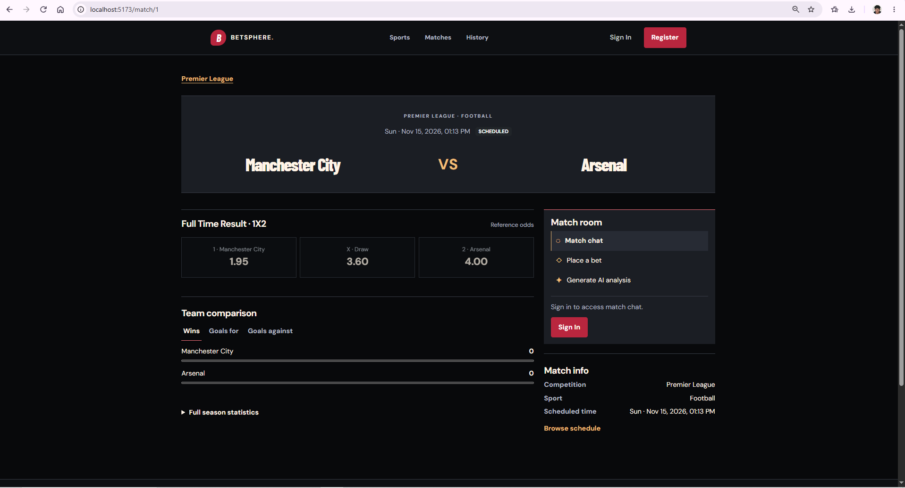

### Estadísticas de un equipo

Desde una competición o un partido se puede abrir la ficha de un equipo. Esta muestra nombre, país, escudo y estadísticas almacenadas de partidos, victorias, empates, derrotas y goles a favor y en contra.

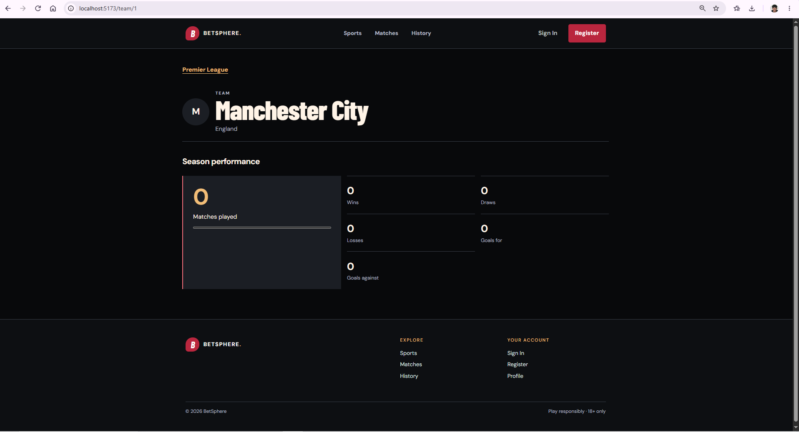

### Registro de cuenta

El registro solicita nombre de usuario, correo, contraseña y fecha de nacimiento. Valida los datos introducidos, comprueba que usuario y correo no estén registrados y exige una edad de al menos 18 años según la fecha declarada. Tras crear la cuenta, se redirige al inicio de sesión.

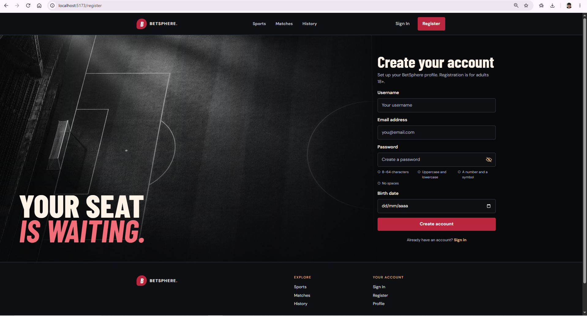

## Usuario registrado

El usuario registrado conserva el acceso a todas las consultas públicas anteriores.

### Inicio y cierre de sesión

El usuario inicia sesión con su correo y contraseña para acceder al perfil y al historial. Si accedió desde una página privada, puede volver a ella tras autenticarse. Puede cerrar la sesión desde el menú de cuenta.

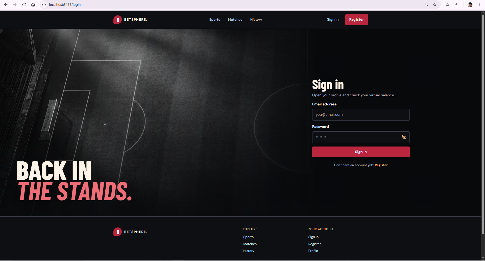

### Consulta del perfil y cambio de avatar

El perfil muestra nombre de usuario, correo, fecha de nacimiento y saldo virtual. La opción «Change photo» permite cambiar el avatar por una imagen JPEG, PNG, WebP o GIF de hasta 5 MiB. La pantalla no incluye edición de los demás datos personales ni operaciones para ingresar o retirar saldo.

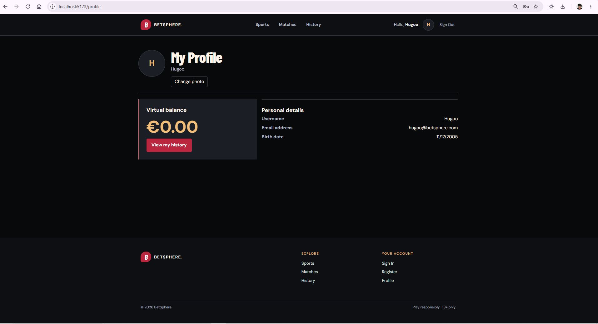

### Consulta de partidos visitados

La página «History» muestra el saldo y hasta cinco partidos visitados con la sesión iniciada. Cada entrada permite volver al partido. Las visitas se guardan por usuario en el navegador; no son un historial de apuestas ni de pérdidas y ganancias.

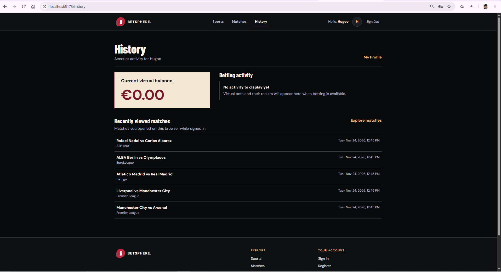

## Usuario administrador

El administrador dispone de las funciones de consulta y cuenta y, además, puede acceder al panel de administración.

### Consulta de usuarios

La pestaña «Users» muestra las cuentas registradas con nombre, correo y roles. Permite buscar entre los registros cargados y solicitar más resultados. Esta vista no ofrece bloqueo ni baneo de usuarios.

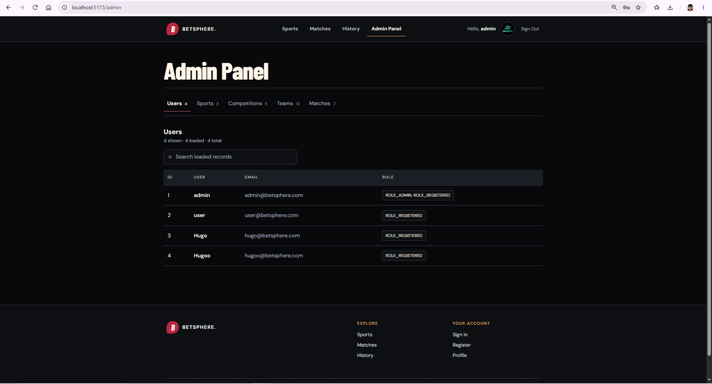

### Gestión del catálogo deportivo

El panel permite crear y editar deportes, competiciones y equipos, así como subir o sustituir sus imágenes. Las competiciones se asocian a un deporte y los equipos se crean vinculados a una competición. Los listados permiten buscar entre los registros cargados y cargar más resultados.

La eliminación de registros requiere confirmación y respeta sus dependencias: no se pueden borrar deportes con competiciones, competiciones con partidos ni equipos que participen en partidos.

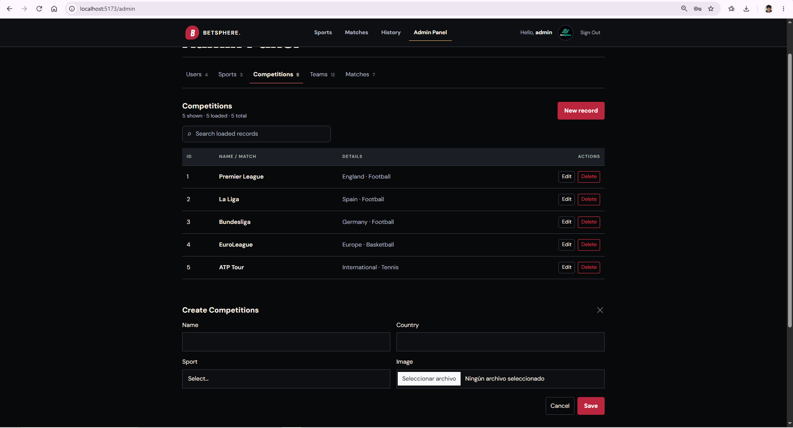

### Gestión de partidos

El formulario de partidos permite elegir competición, equipos local y visitante, fecha y hora, cuotas 1X2 y estado. Los equipos deben ser distintos y pertenecer a la competición seleccionada. El estado puede cambiarse manualmente a programado, en directo o finalizado; no se actualizan marcadores en vivo.

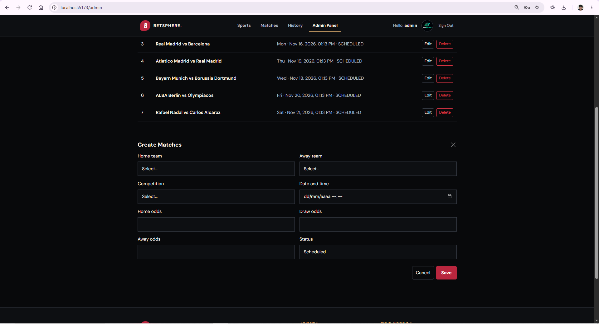

El estado de las funcionalidades previstas que todavía no están disponibles se recoge en [Funcionalidades detalladas](detailed-functionalities.md).
